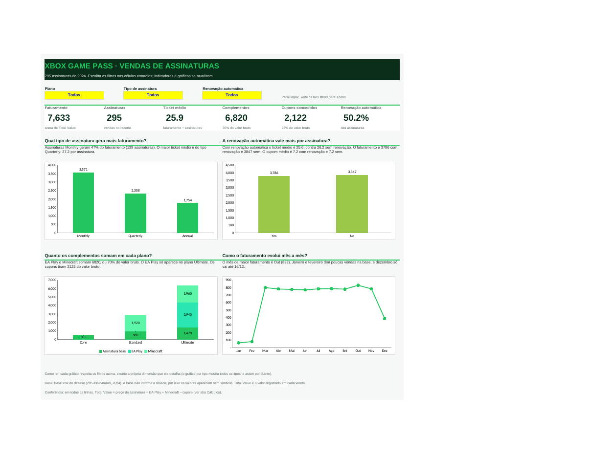
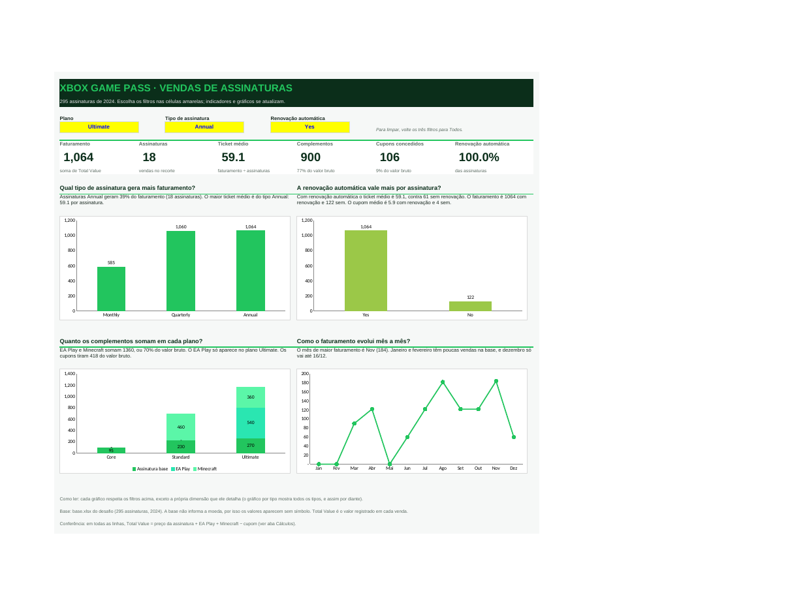

# Dashboard de vendas de assinaturas Xbox Game Pass no Excel

Dashboard em Excel que transforma a base de assinaturas do desafio em indicadores e gráficos que respondem a perguntas de negócio. Tudo é calculado por fórmulas: ao trocar um filtro, os indicadores, os textos de resposta e os gráficos se atualizam.

Arquivo principal: [`Dashboard_Xbox.xlsx`](Dashboard_Xbox.xlsx)



## Dados utilizados

Base `base.xlsx`, fornecida no desafio: 295 assinaturas iniciadas entre 01/01/2024 e 16/12/2024.

| Coluna | Conteúdo |
|---|---|
| Subscriber ID, Name | Identificação do assinante (dados de exemplo) |
| Plan | Core, Standard ou Ultimate |
| Start Date | Data de início da assinatura |
| Auto Renewal | Yes ou No |
| Subscription Price, Subscription Type | Preço do plano e tipo (Monthly, Quarterly ou Annual) |
| EA Play Season Pass e preço | Complemento vendido só no plano Ultimate. O preço vem como "-" quando não há compra |
| Minecraft Season Pass e preço | Complemento, com preço 0 quando não há compra |
| Coupon Value | Desconto aplicado |
| Total Value | Valor registrado da venda |

## Perguntas de negócio

1. Qual tipo de assinatura gera mais faturamento? As assinaturas mensais lideram, com 47% do faturamento (3.571 de 7.633). O maior ticket médio é do trimestral, com 27,2.
2. A renovação automática vale mais por assinatura? Não. O ticket médio é 25,6 com renovação e 26,2 sem. A renovação automática, aqui, não muda o valor médio da venda.
3. Quanto os complementos (EA Play e Minecraft) somam em cada plano? Somam 6.820, ou 70% do valor bruto de 9.755. O EA Play só aparece no plano Ultimate, que concentra a maior parte do faturamento (5.388 de 7.633). Os cupons tiram 2.122 do valor bruto.
4. Como o faturamento evolui mês a mês? Fica entre 770 e 832 de março a novembro, com pico em outubro. Janeiro e fevereiro têm só 2 assinaturas cada, e dezembro só vai até o dia 16.

Escolhi estas perguntas porque ligam o resultado a decisões: onde está a receita, se a renovação automática compensa, o peso dos complementos e o ritmo ao longo do ano.

## Filtros

Três células amarelas com lista suspensa no topo do Dashboard: Plano, Tipo de assinatura e Renovação automática. Cada gráfico respeita os outros filtros, mas mostra todas as categorias da própria dimensão (o gráfico por tipo, por exemplo, sempre mostra os três tipos).

Exemplo de filtro aplicado: Plano Ultimate, tipo Annual, renovação Yes. O resultado é 18 assinaturas, faturamento de 1.064 e ticket médio de 59,1.



## Como o arquivo está organizado

| Aba | Para que serve |
|---|---|
| Dashboard | Filtros, seis indicadores, quatro gráficos e o texto de resposta de cada pergunta |
| Cálculos | Todas as fórmulas: critérios dos filtros, indicadores, e uma tabela por pergunta |
| Bases | A base original (colunas A a M, sem alteração) e quatro colunas auxiliares (N a Q) |

## Como funciona por dentro

1. Os filtros do Dashboard viram critérios na aba Cálculos. Quando o filtro está em "Todos", o critério vira `*`, que aceita qualquer texto.
2. Os indicadores usam `SUMIFS` e `COUNTIFS` sobre a aba Bases.
3. Os textos de resposta são fórmulas que montam a frase a partir dos resultados, com `INDEX`, `MATCH` e `MAX`.
4. Os gráficos leem as tabelas da aba Cálculos.

## Tratamento da base

1. O preço do EA Play vem como texto "-" em 197 linhas. A coluna auxiliar O converte para 0, para a soma funcionar.
2. A coluna auxiliar N guarda o mês de início de cada assinatura, usado no gráfico mensal.
3. As colunas P e Q recalculam o valor bruto e conferem que Total Value = preço da assinatura + EA Play + Minecraft − cupom. Nas 295 linhas, a conferência fecha (0 divergências). O resultado aparece na aba Cálculos.
4. Não encontrei valores vazios nem IDs repetidos. Há 15 nomes repetidos com IDs diferentes, o que é esperado em dados de exemplo.

## Decisões e limitações

1. A base não informa a moeda. Os valores aparecem sem símbolo.
2. Total Value é o valor registrado da venda. Nas assinaturas anuais, ele não é multiplicado por 12 (um plano Core anual tem valor 5, igual ao mensal). Por isso o tipo anual parece render pouco por assinatura. Antes de tirar conclusão sobre planos anuais, vale confirmar o que Total Value representa.
3. Dados de janeiro, fevereiro e dezembro são parciais, o que distorce a leitura da curva mensal.
4. O texto da pergunta 4 cita janeiro, fevereiro e dezembro como fatos desta base. Se você trocar a base, atualize essa frase.
5. As fórmulas atendem até 999 linhas de dados. Para mais, estenda as fórmulas das colunas N a Q e os intervalos da aba Cálculos.
6. Usei listas suspensas nas células em vez de segmentações de dados, porque as listas são criadas e conferidas por fórmula.

## Como reproduzir

1. Abra o `Dashboard_Xbox.xlsx` no Excel.
2. Para usar outra base com as mesmas colunas, cole os dados na aba Bases, nas colunas A a M, a partir da linha 2, e apague as linhas antigas que sobrarem.
3. Volte ao Dashboard e escolha os filtros.
4. Revise o texto da pergunta 4 (limitação 4).

A paleta de cores é a da aba Assets da base original: verdes #22C55E, #2AE6B1, #9BC848 e #5BF6A8, e cinza #E8E6E9. Usei o dashboard finalizado do desafio só para ver o estilo. As perguntas, as fórmulas e os gráficos são meus.

## Aprendizados

Aprendi a transformar uma base de dados bruta em um dashboard interativo no Excel, utilizando fórmulas como SUMIFS, COUNTIFS, INDEX e MATCH para criar indicadores, filtros dinâmicos e gráficos voltados a perguntas de negócio.

Também desenvolvi habilidades de organização e validação de dados, conferência de valores, análise de faturamento e interpretação de resultados conforme diferentes cenários. O projeto reforçou a importância de garantir a consistência das informações e apresentar dados de forma visual, clara e objetiva, facilitando a identificação de oportunidades e a tomada de decisões baseadas em dados.

## Estrutura do repositório

```
.
├── README.md
├── Dashboard_Xbox.xlsx
├── print-dashboard.png
└── print-filtro.png
```
